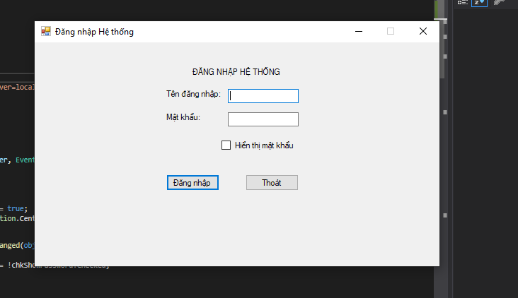
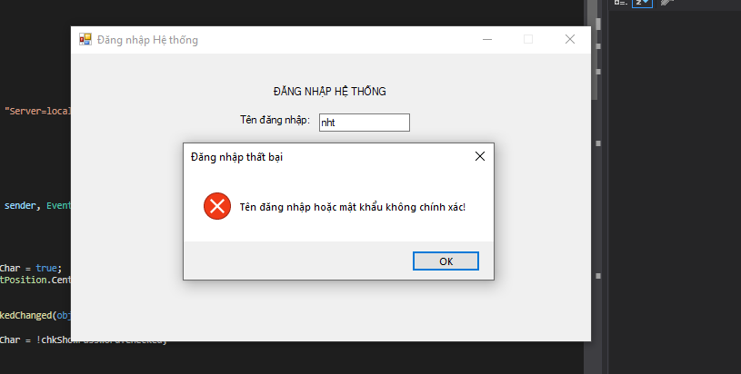
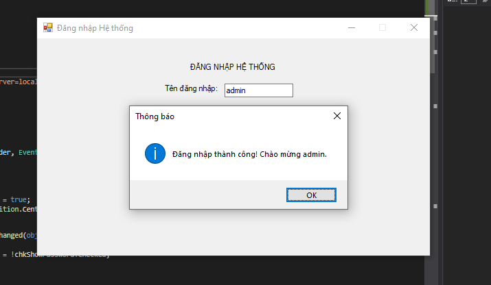
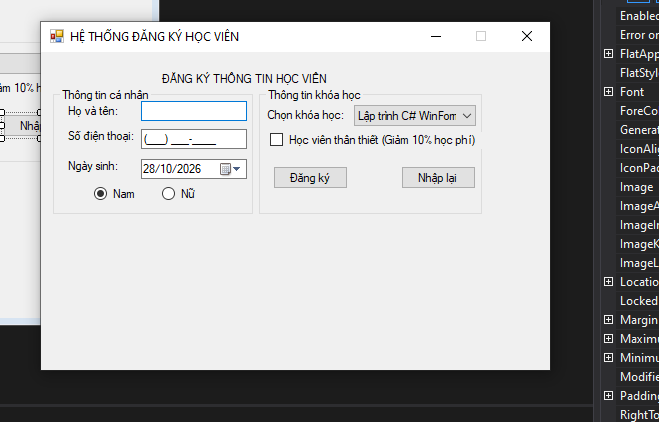
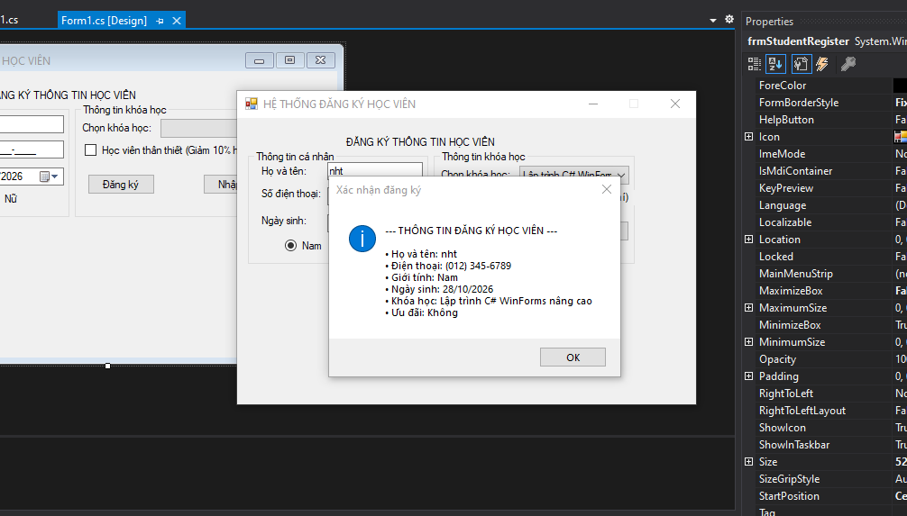
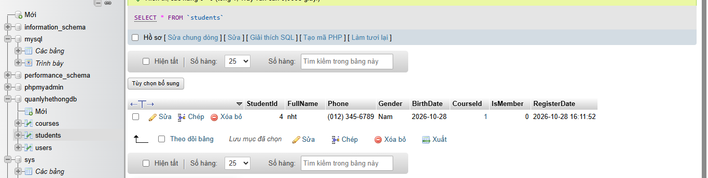

# BÁO CÁO BÀI TẬP THỰC HÀNH LẬP TRÌNH C# WINFORMS

## I. THÔNG TIN SINH VIÊN

- **Họ và tên:** Nguyễn Hữu Trường
- **Mã số sinh viên:** 24810320290
- **Lớp học phần:** D19QTANM1 - Tên môn học: Lập trình C# / Windows Forms
- **Link Repository:** https://github.com/truong-blue/Bai5.x.git

---

## II. DANH SÁCH BÀI TẬP HOÀN THÀNH & TỰ ĐÁNH GIÁ

| Bài tập | Tiêu đề bài tập | Trạng thái | Mức độ hoàn thành (%) |
| :---: | :--- | :---: | :---: |
| **Bài 5.1** | Nâng cấp Login Form chuẩn UX lưu CSDL MySQL (XAMPP) | Hoàn thành | 100% |
| **Bài 5.2** | Nâng cấp Form Đăng ký Học viên lưu CSDL MySQL (XAMPP) | Hoàn thành | 100% |

---

## III. MINH HỌA GIAO DIỆN & KỸ THUẬT NỔI BẬT

### 1. Bài 5.1: Form Đăng Nhập chuẩn UX lưu CSDL MySQL
- **Kỹ thuật áp dụng:** 
  - Gán phím tắt chuẩn UX (`AcceptButton` cho phím Enter kích hoạt đăng nhập, `CancelButton` cho phím Esc kích hoạt thoát).
  - CheckBox ẩn/hiện mật khẩu thông qua thuộc tính `UseSystemPasswordChar`.
  - Validation bắt lỗi trống Tên đăng nhập & Mật khẩu bằng `ErrorProvider`.
  - Tích hợp thư viện NuGet `MySql.Data` (`MySqlConnection`, `MySqlCommand`) kết nối CSDL MySQL trên XAMPP/phpMyAdmin với Parameterized Query chống SQL Injection.

- **Hình ảnh minh họa Giao diện:**

*Mô tả: Giao diện Form Đăng nhập thiết kế chuẩn UX với ẩn mật khẩu và gắn phím tắt Enter/Esc.*

*Mô tả: Thông báo lỗi khi người dùng nhập sai Tên đăng nhập hoặc Mật khẩu.*

*Mô tả: Thông báo Đăng nhập thành công sau khi xác thực dữ liệu khớp trong bảng Users CSDL MySQL.*

---

### 2. Bài 5.2: Form Đăng Ký Học Viên với Input Controls & CSDL MySQL
- **Kỹ thuật áp dụng:** 
  - Đặt Mask chuẩn cho Số điện thoại `(000) 000-0000` với `MaskedTextBox`.
  - Format hiển thị Ngày sinh chuẩn `dd/MM/yyyy` bằng `DateTimePicker`.
  - Dynamic Data Binding danh sách Khóa học vào `ComboBox` từ CSDL với `DisplayMember` (Tên khóa học) và `ValueMember` (Mã khóa học).
  - Validation `ErrorProvider` bắt lỗi trống dữ liệu nhập.
  - Tổng hợp thông tin in lên `MessageBox` và thực thi câu lệnh SQL `INSERT INTO Students` lưu bản ghi mới vào CSDL MySQL.

- **Hình ảnh minh họa Giao diện:**

*Mô tả: Form Đăng ký Học viên với đầy đủ các Input Controls (ComboBox, MaskedTextBox, RadioButton, CheckBox).*

*Mô tả: Tổng hợp thông tin đăng ký học viên và lưu bản ghi mới thành công vào MySQL.*

*Mô tả: Dữ liệu học viên mới tự động đồng bộ và hiển thị trên giao diện quản lý CSDL phpMyAdmin.*
## IV. HƯỚNG DẪN CÀI ĐẶT & CHẠY DỰ ÁN

1. Clone Repository về máy:
git clone [https://github.com/truong-blue/Bai_Tap_12_10.git](https://github.com/truong-blue/Bai5.x.git)
2. Import file CSDL database/QuanLyHeThongDB.sql vào MySQL / phpMyAdmin trong XAMPP.
3. Mở file solution src/WinFormsAppSolution.sln bằng Visual Studio 2019.
4. Bấm F5 hoặc chọn Start để biên dịch và chạy chương trình.